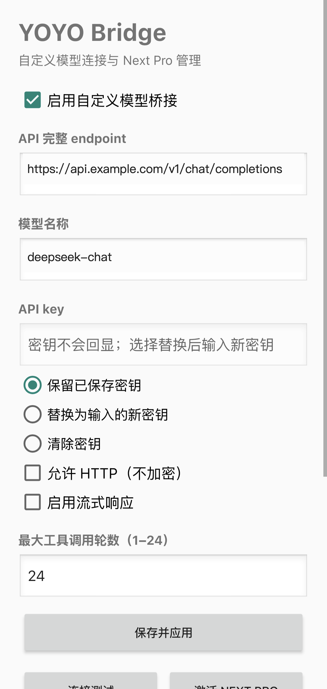
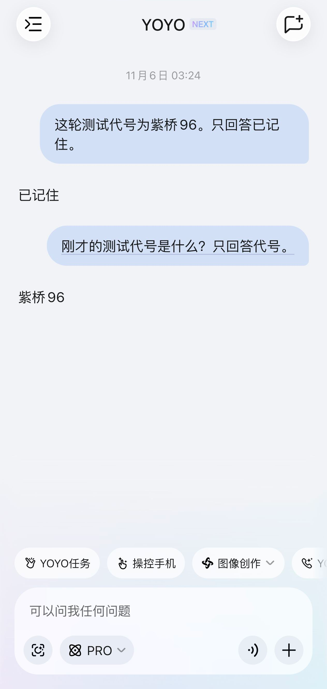
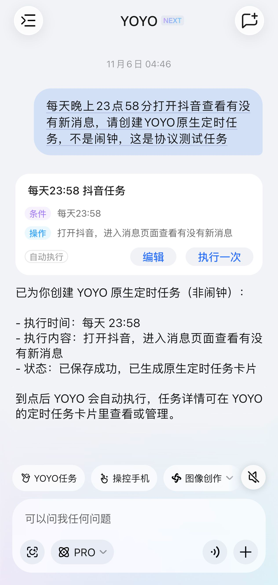
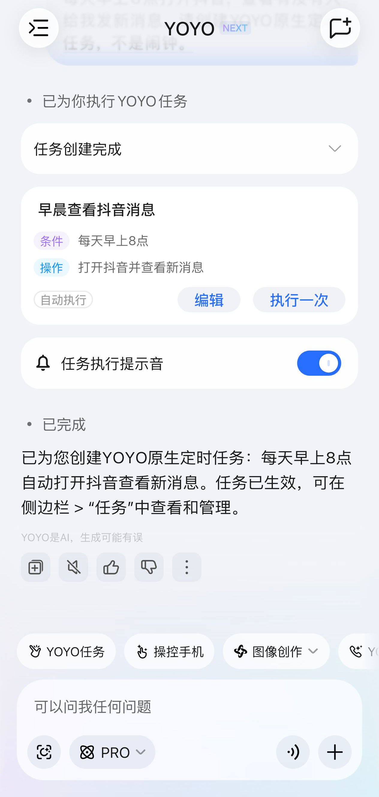
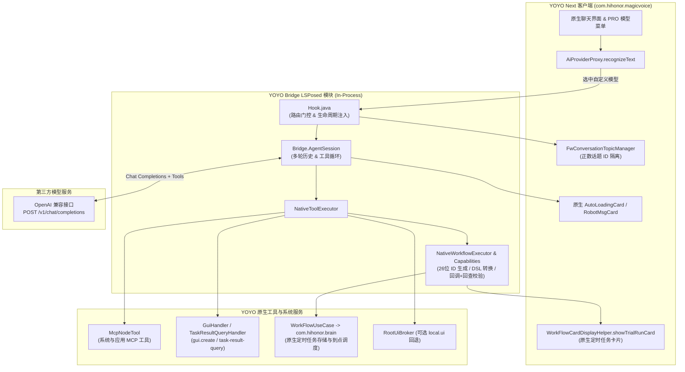

# YOYO Bridge LSPosed (`yoyo-bridge-lsp`)

[](CHANGELOG.md)
[-3DDC84.svg)](helper/AndroidManifest.xml)
[](helper/AndroidManifest.xml)
[](LICENSE)

**YOYO Bridge LSPosed** 是一个面向荣耀 **YOYO Next (`com.hihonor.magicvoice`)** 的独立 LSPosed 模块。项目目标是**保留 YOYO 原生客户端、手机工具调用能力、会话管理与原生特殊 UI 卡片**，仅将负责生成决策的模型环节替换为任意兼容 OpenAI `/v1/chat/completions` 协议的第三方大模型，并在客户端内按 YOYO 原生协议补齐工具调度与工作流卡片链路。

> **基线适配环境**：MagicOS 11 / Android 17，YOYO 智能体 `90.10.35.036`（`versionCode=901035036`）。不同版本 YOYO 若存在混淆或类签名变动，可先通过内置的 `tests/native-api` 工具核对目标 DEX 签名。

---

## 核心特性

- **原生路线切换与零污染隔离**：
  - 在 YOYO Next 的 `PRO` 模型菜单中注入自定义模型入口，仅在用户实际选中自定义模型（`selectedCustom`）时才接管请求与本地网关路由；切回“系统默认模型”时完全恢复荣耀原生云端链路。
- **纯原生 Material 管理界面（无 WebView / WebUI）**：
  - 内置轻量级 `SettingsActivity`（`@android:style/Theme.Material.Light.NoActionBar`），支持配置 API Endpoint、Model ID、API Key、流式开关、最大工具轮数、连接测试与一键激活 Next Pro。
- **多轮话题上下文自动隔离**：
  - 绑定 YOYO 原生 `FwConversationTopicManager` 正数话题 ID，自动等待首轮输入卡异步落库并检测话题切换，防止跨话题串话；新开话题自动从空上下文开始。
- **原生手机工具与 GUI 自动化直连**：
  - 同一 YOYO 进程内通过 `NativeToolExecutor` 直接调用原生 `McpNodeTool`、`gui.create`（异步创建手机 GUI 操控任务）与 `task-result-query`（查询任务执行终态），并提供可选的 Root 级 `local.ui`（`RootUiBroker`）回退通道。
- **YOYO 原生每日 GUI 定时任务卡片生成与持久化（v2.2.0）**：
  - 提供 `workflow.create_daily_gui` 与 `workflow.get_status` 工具，支持第三方模型创建真正的 **YOYO 原生定时任务**（非系统闹钟）。
  - 自动学习并净化原生工作流插件能力元数据，生成独立 26 位十进制 `workflowId`，复用原生 DSL 转换、`validateGroupTasks` 校验、`WorkFlowUseCase.addOrUpdateWorkFlow` 持久化（写入 `com.hihonor.brain`）以及 `WorkFlowCardDisplayHelper.showTrialRunCard` 原生任务卡渲染。
- **被动脱敏协议观测器（`NativeTrace`）**：
  - 支持通过开关文件按需启用 JSONL 协议跟踪，覆盖主对话、工具执行与工作流关键方法，自动对 `token`、`authorization`、`apikey`、`cookie` 等字段做 `[REDACTED]` 脱敏处理。

---

## 界面与真机效果预览

| 原生 Material 管理页 | 第三方模型多轮追问（话题隔离） | 第三方模型创建原生定时任务卡 | 系统默认模型定时任务卡对照 |
| :---: | :---: | :---: | :---: |
|  |  |  |  |

---

## 架构与协议边界



### 已验证能力与当前边界说明

| 能力维度 | 当前状态 | 边界与说明 |
| --- | --- | --- |
| 普通问答与同话题连续追问 | ✅ 已验证 | 基于 `FwConversationTopicManager` 正数话题 ID 保持多轮上下文，后台等待首轮异步落库并防止跨话题串话。 |
| 新建话题上下文隔离 | ✅ 已验证 | 切换新话题后自动以空历史发起新会话，不携带旧话题记忆。 |
| 原生手机 MCP 与 GUI 操控 | ✅ 已验证 | 直接复用进程内 `McpNodeTool`、`gui.create` 与 `task-result-query`。 |
| 每日 GUI 原生定时任务与卡片 | ✅ 已验证 | 第三方模型决策参数 -> 原生 DSL 转换 -> `com.hihonor.brain` 保存 -> 原生卡片展示 -> 到点自动唤醒执行。 |
| 完整云端 `startDialog` 流式富文本与全局编排替代 | ⚠️ 部分适配 | 原生主对话通过 `startDialog` 复合事件流（含 `AgentState`、`ToolCallHint`、`commonQA`、`FinishTask`）驱动 `PlanManager`；当前 Bridge 主要通过工具循环与卡片接口回填，尚未 1:1 模拟荣耀云端全部内部编排。详见 [`docs/protocol-boundary.md`](docs/protocol-boundary.md)。 |
| 云端主对话原版 System Prompt | ℹ️ 已核查 | 客户端 `PlanModelPromptBuilder` 实为端侧 AIMM VLM 工具规划模板（输出受限 DSL），云端 `startDialog` 的主对话 System Prompt 在服务端组装，不在客户端请求包中暴露。详见 [`docs/prompt-analysis.md`](docs/prompt-analysis.md)。 |

---

## 快速开始

### 1. 安装与激活模块

1. 下载最新 Release 中的 `yoyo-bridge-lsp-2.2.0.apk`（或自行从源码构建）并安装到手机。
2. 打开 **LSPosed 管理器**，启用 **YOYO Bridge** 模块，勾选作用域 **`com.hihonor.magicvoice`**（YOYO 智能体）。
3. 打开桌面上的 **YOYO Bridge** 应用：
   - 勾选 **启用自定义模型桥接**。
   - 填写完整的 **API endpoint**（例如 `https://api.example.com/v1/chat/completions`）。
   - 填写 **模型名称**（例如 `deepseek-chat`、`gpt-4o` 等支持 Tool Calling 的模型）。
   - 选择 **替换为输入的新密钥** 并填入 API Key，点击 **保存并应用**。
4. 点击 **连接测试**，确认返回 HTTP 200 且连通正常后，点击 **激活 NEXT PRO**。
5. 重新打开 YOYO，在底部 `PRO` 模型切换菜单中确认当前已选中 **自定义模型**（无需整机重启，修改配置后仅需重开 YOYO 进程）。

### 2. 使用原生每日定时任务（v2.2.0+）

1. **首次学习原生工作流元数据**：如果在全新安装后尚未采集过原生工作流插件元数据，可先在 YOYO 的 `PRO` 菜单切换至“系统默认模型”，发送一次定时任务请求（例如“每天早上 8 点打开抖音查看新消息”）。模块会在后台自动学习并脱敏保存当前版本 YOYO 的工作流工具元数据（仅保留静态 `toolId`/`pluginId`/`pkgName`/`version`），随后即可停用该示例任务并切回“自定义模型”。
2. **使用第三方模型创建原生定时任务**：在“自定义模型”下直接发送自然语言指令（如“每天早上 8 点打开抖音查看有没有新消息”），第三方模型会自动调用 `workflow.create_daily_gui` 并在聊天窗口渲染出包含“条件、操作、自动执行、编辑、执行一次”的原生定时任务卡片。

---

## 从源码构建与测试

### 环境要求

- **Python** 3.9+
- **JDK** 11+（脚本使用 `--release 8` 编译字节码）
- **Android SDK Build Tools & Platform**：需要 `android.jar`、`aapt2`、`zipalign`、`apksigner`
  - 脚本会自动从 `ANDROID_SDK_ROOT` / `ANDROID_HOME`（或 `~/Library/Android/sdk`、`~/Android/Sdk`）探测最新版本的构建工具，也支持通过环境变量显式指定：
    - `ANDROID_JAR`：`android.jar` 路径
    - `AAPT2`：`aapt2` 可执行文件路径
    - `ZIPALIGN`：`zipalign` 可执行文件路径
    - `APKSIGNER`：`apksigner` 可执行文件路径
    - `JAVA_HOME`：JDK 根目录

### 构建 APK

```bash
python3 build_lsp.py
```

- 构建脚本会自动下载并校验固定版本的 Google R8 (`9.5.28`) 与 `org.json` (`20250517`) 到 `build/tools/`。
- `helper/api/de/robv/android/xposed/` 下的 Xposed API Stub 仅用于编译期类型检查，不会打包进最终的 `classes.dex`。
- 若未通过 `KEYSTORE_PATH` 指定签名证书，脚本会在本地 `build/helper/helper.keystore` 自动生成开发签名证书（已被 `.gitignore` 忽略，不会进入版本库），并对输出的 `dist/yoyo-bridge-lsp-2.2.0.apk` 执行 v2/v3 签名校验。

### 运行自动化测试

1. **后端与网关协议测试套件（33 项测试）**：
   ```bash
   BRIDGE_JSON_JAR="$PWD/build/tools/json.jar" python3 tests/test_backend.py
   ```
   覆盖配置原子保存、密钥隐藏、HTTP/HTTPS 与重定向安全策略、SSE 流式解析、OpenClaw WebSocket 分片重组、多轮话题隔离、配置轮转修复以及 `gui.create` / `task-result-query` 工具调用闭环。

2. **工作流契约测试（纯 Java）**：
   ```bash
   mkdir -p build/test-workflow
   javac --release 8 -cp "build/tools/json.jar:$ANDROID_JAR" -d build/test-workflow \
     helper/src/dev/yoyobridge/helper/NativeWorkflowCapabilities.java \
     helper/src/dev/yoyobridge/helper/NativeWorkflowExecutor.java \
     tests/workflow/TestMetadata.java \
     tests/workflow/TestPayload.java
   java -cp "build/test-workflow:build/tools/json.jar:$ANDROID_JAR" \
     dev.yoyobridge.helper.TestMetadata tests/workflow/synthetic-native-shape.json
   java -cp "build/test-workflow:build/tools/json.jar:$ANDROID_JAR" \
     dev.yoyobridge.helper.TestPayload tests/workflow/synthetic-native-shape.json
   ```

3. **目标 DEX 真实 JVM 方法签名核对（可选，需提供本机提取的 `classes20.dex` 与 JADX 1.5.6 JAR）**：
   详见 [`tests/native-api/README.md`](tests/native-api/README.md)。

---

## 仓库目录结构

```text
.
├── build_lsp.py                 # 零硬编码路径的自动化构建、D8 编译与 APK 签名校验脚本
├── CHANGELOG.md                 # 版本演进记录 (v2.0.0 -> v2.2.0)
├── LICENSE                      # MIT 开源许可证
├── README.md                    # 项目说明文档
├── docs/
│   ├── protocol-boundary.md     # YOYO Next 原生协议边界与工作流架构分析
│   ├── prompt-analysis.md       # 端侧 VLM 规划提示词模板与云端 startDialog 核查
│   └── images/                  # 脱敏处理后的界面与真机运行截图
├── src/
│   └── dev/yoyobridge/
│       └── Bridge.java          # 核心桥接网关、AgentSession、多轮对话缓存与工具循环
├── helper/
│   ├── AndroidManifest.xml      # 模块清单（Xposed 元数据、权限与 Provider 声明）
│   ├── assets/xposed_init       # Xposed 入口类声明
│   ├── res/values/scope.xml     # 默认作用域 (com.hihonor.magicvoice)
│   ├── api/                     # 编译期 Xposed API Stub（不打入 DEX）
│   └── src/dev/yoyobridge/helper/
│       ├── Hook.java                      # LSPosed 注入入口、路由门控与方法 Hook
│       ├── SettingsActivity.java          # 原生 Material 配置管理界面
│       ├── BridgeSettingsProvider.java    # UID 受限配置与脱敏状态 ContentProvider
│       ├── NativeToolExecutor.java        # 原生 MCP / GUI 工具进程内执行器
│       ├── NativeWorkflowCapabilities.java# 原生工作流能力元数据自学习与脱敏存储
│       ├── NativeWorkflowExecutor.java    # 每日 GUI 定时任务组装、DSL 转换、保存与卡片渲染
│       ├── NativeTrace.java               # 按需启停的被动脱敏 JSONL 协议观测器
│       ├── NativeRootManager.java         # 可选 Root UI Broker 进程管理
│       ├── NativeRootClient.java          # 抽象域套接字客户端
│       └── RootUiBroker.java              # 可选 Root 级无障碍/截图回退服务
└── tests/
    ├── test_backend.py          # 33 项后端与协议自动化测试
    ├── fixtures/                # 脱敏后的应用层解码消息样本
    ├── workflow/                # 每日定时工作流纯 Java 契约测试
    └── native-api/              # 目标 DEX 真实 JVM 方法签名核对工具
```

---

## 安全与隐私设计

- **密钥本地隔离与零回显**：API Key 仅保存在管理应用与 YOYO 各自的应用私有目录中（权限 `0600`），不在 UI 界面回显，并在 `BridgeSettingsProvider` 返回的状态快照与日志中自动将密钥及 `Authorization` 头替换为 `[已隐藏]`。
- **调用方 UID 与签名权限校验**：`BridgeSettingsProvider` 严格校验调用方 UID（仅允许模块自身与 `com.hihonor.magicvoice` 访问）；控制广播受 `signature` 级自定义权限 `dev.yoyobridge.helper.CONTROL` 保护。
- **脱敏被动观测**：`NativeTrace` 默认关闭（需手动在私有目录创建 `native-trace.enabled` 方可启用），且对所有包含敏感键名的字段自动执行 `[REDACTED]` 过滤。
